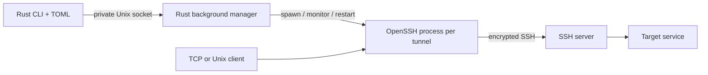

<div align="center">

# boring-rs

**Named SSH tunnels. One config. A background manager written in Rust.**

[](https://github.com/delirium95/ssh-tunnel-manager/actions/workflows/ci.yml)
[](LICENSE)

</div>

A Rust reimplementation of the tunnel-manager workflow from [Boring](https://github.com/alebeck/boring).
Rust handles configuration, the CLI, daemon IPC, process supervision, status and reconnection. **System OpenSSH provides the SSH protocol and forwards the traffic.** This is an independent project, not an official Boring release or a new cryptographic implementation.

```text
$ boring-rs open --group development
Opened dev-db [local] via dev-server
Opened dev-web [local] via dev-server

$ boring-rs list
STATUS         NAME                   GROUP          MODE             LOCAL                    REMOTE                   VIA
open           dev-db                 development    local            5433                     127.0.0.1:5432           dev-server
open           dev-web                development    local            127.0.0.1:8080           127.0.0.1:3000           dev-server

$ boring-rs close 'dev-*'
Closed dev-db
Closed dev-web
```

## Features

- Local (`-L`), remote (`-R`), SOCKS5 (`-D`) and reverse SOCKS forwarding.
- TCP, IPv6 and Unix sockets; TCP/Unix endpoints can be mixed.
- Named tunnels, groups, quoted glob patterns and a familiar TOML format.
- Background manager started on demand; tunnels outlive the CLI.
- Automatic reconnect with exponential backoff, a time budget and visible states.
- Keep-alives, strict host-key verification and noninteractive authentication.
- OpenSSH config, certificates, `ssh-agent`, ProxyJump and ProxyCommand through OpenSSH.
- Table or JSON output; running tunnels remain manageable after config edits/removal.
- Bash, Zsh and Fish completion of configured names, running names and groups.
- Private Unix-domain IPC, an exclusive daemon lock and bounded message sizes.
- Graceful shutdown, process-group cleanup and diagnostics returned to the CLI.

**Platforms:** macOS and Linux. Use WSL on Windows; native Windows support is not implemented.

## Install

Requires Rust **1.88+**, the platform's normal C linker/build tools, and OpenSSH **8.0+** in `PATH`. Remote forwarding also requires a server that permits the requested forwarding. No root privileges are needed to run the manager.

```sh
git clone https://github.com/delirium95/ssh-tunnel-manager.git
cd ssh-tunnel-manager
cargo install --path . --locked
boring-rs --version
```

For a development build:

```sh
cargo build --locked
./target/debug/boring-rs --help
```

## Quick start

```sh
boring-rs init               # creates an example; never overwrites an existing config
boring-rs edit               # VISUAL, EDITOR, or vi
boring-rs open dev-db --dry-run
boring-rs open dev-db
boring-rs list
boring-rs close dev-db
boring-rs shutdown
```

Change `dev-server` in the example to your SSH alias or host. Verify that host with ordinary SSH first. Load encrypted keys into `ssh-agent` using `ssh-add`. The manager uses `BatchMode=yes` and will not ask for a password, key passphrase or trust confirmation in the background.

For a local tunnel, `local` is on your computer and `remote` is resolved **from the SSH server**. For a remote tunnel, the server listens at `remote` and connects back to `local` on your computer.

## Commands

| Command | Purpose |
| --- | --- |
| `open`, `o` `NAME...` | Open a union of names or quoted patterns |
| `open --all` / `open --group GROUP` | Open a batch |
| `open ... --dry-run` | Validate and show arguments without connecting or starting a daemon |
| `close`, `c` | Same selection options; selects the manager's entries, not the config file |
| `list`, `l`, `ls` | Configured entries plus active/reconnecting/failed entries |
| `list --group GROUP` | Filter by group; `default` means ungrouped |
| `list --json` | Structured status, connection time, retry count and last error |
| `init` / `edit`, `e` | Create or edit the configuration |
| `shutdown` | Close every tunnel and stop the daemon |
| `version`, `v` / `help`, `h` | Version and help |
| `completions SHELL` / `--shell SHELL` | Shell completion setup |

`--config FILE` (`-f`) and `--runtime-dir DIR` work before or after subcommands. Reopening an unchanged tunnel is idempotent. To apply changed settings, close it and open it again. If one entry in a batch fails, the others can remain open; inspect `list --json`.

## Configuration

Default file locations follow Boring:

- macOS: `~/.boring.toml`.
- Linux: `$XDG_CONFIG_HOME/boring/.boring.toml`, otherwise `~/.config/boring/.boring.toml`.
- Override with `BORING_CONFIG` or `--config`.

```toml
keep_alive = 30
reconnect_timeout = 900

[[tunnels]]
name = "dev-db"
group = "development"
host = "dev-server"
local = 5433
remote = "127.0.0.1:5432"

[[tunnels]]
name = "reverse-web"
host = "dev-server"
mode = "remote"
local = "127.0.0.1:3000"
remote = 8081

[[tunnels]]
name = "proxy"
host = "dev-server"
mode = "socks"
local = 1080

[[tunnels]]
name = "reverse-proxy"
host = "dev-server"
mode = "socks-remote"
remote = 1081
```

See [examples/config.toml](examples/config.toml) for Unix sockets and explicit SSH credentials.

| Field | Meaning |
| --- | --- |
| `name` | Unique name: letters/digits and `._-`, starting with a letter/digit; at most 100 bytes |
| `host` | SSH alias, hostname or unbracketed IPv6 address |
| `mode` | `local` (default), `remote`, `socks`, `socks-remote`; `l`/`-l`, `r`/`-r` aliases |
| `local` | Required for local, remote and SOCKS modes |
| `remote` | Required for local, remote and reverse SOCKS modes |
| `user`, `port`, `identity` | Optional overrides; otherwise OpenSSH's config/agent/defaults apply |
| `group` | Optional batch label; `default` is reserved for ungrouped entries |
| `keep_alive` | Global or per tunnel, seconds; default 120; 0 disables keep-alives |
| `reconnect_timeout` | Global or per tunnel, seconds; default 900; 0 disables reconnect |

Ports accept TOML integers or strings. A short listening port such as `5433` binds **127.0.0.1:5433**; explicit addresses can bind other interfaces. Use `[::1]:5433` for IPv6. Forward destinations require `host:port`, `[IPv6]:port` or an absolute Unix socket path. Unix socket paths must fit within 100 bytes and contain no `:`. Up to 128 entries are supported per manager.

`$VAR`, `${VAR}` and `${VAR:-fallback}` expand in `host`, `user`, `identity`, `port`, `local` and `remote`. `~/` expands in identity and socket paths. Names and groups are literal. Unknown fields and duplicate names are rejected, so typos cannot silently change behavior.

## How it works



The manager holds an OS file lock, accepts framed JSON IPC and supervises one foreground OpenSSH process per tunnel. A dedicated SSH control socket confirms connection readiness. The CLI waits for `open` or a diagnostic instead of treating `spawn()` as a successful connection.

States are `closed → connecting → open → reconnecting → open/failed`. The first failed connection returns an error without retrying indefinitely. After an established session drops, retries start at 500 ms and double up to 60 seconds until `reconnect_timeout` expires. Closing a tunnel during reconnect cancels retries. A successful reconnection creates a new session; application connections that were interrupted must reconnect themselves.

`open` confirms SSH and forwarding setup, **not the health of the destination application**. OpenSSH resolves/dials that destination when traffic arrives. Keep-alives detect unresponsive peers; they do not replay requests or recover application transactions.

## Runtime and authentication

| Variable | Default / effect |
| --- | --- |
| `BORING_CONFIG` | Config file override |
| `BORING_RUNTIME_DIR` | `/tmp/boring-rs-<uid>`; private directory, mode 0700 |
| `BORING_SOCK` | `<runtime>/daemon.sock`; parent must be private and user-owned |
| `BORING_LOG_FILE` | `<runtime>/daemon.log`; private regular file |
| `VISUAL` / `EDITOR` | Editor command; quoted arguments supported without a shell |

Use the same runtime settings for every command that talks to an instance. Custom runtime paths must be absolute and shorter than 75 bytes; their parent directory must already exist. `--runtime-dir` creates an isolated instance without changing the config. SSH diagnostic logs are private, bounded when read, reset per reconnect attempt and removed when an entry is closed. Daemon lifecycle logs remain in `daemon.log`.

Host keys must already be trusted: `StrictHostKeyChecking=yes` is enforced. SSH input is passed as separate process arguments. Existing SSH config remains trusted input: its ProxyCommand, Match exec, forwards and authentication settings may also apply. Do not treat an arbitrary downloaded SSH config as safe.

`shutdown`, SIGINT, SIGTERM and SIGHUP close and reap supervised SSH processes. Linux additionally sets a parent-death signal. On macOS, killing the daemon with SIGKILL can leave SSH processes running; use `shutdown` for normal operation. Manager state is in memory: a daemon restart or machine reboot does not automatically reopen the previous set.

Unix sockets require server support and suitable directory permissions. Local listener paths created by this manager are removed only while their recorded inode still matches. Existing paths are never blindly unlinked. Remote Unix socket cleanup/rebinding is governed by the SSH server; some setups require server-side `StreamLocalBindUnlink` configuration. Explicit `localhost` TCP binds can behave differently across IPv4/IPv6; use literal IPs for a specific interface.

## Shell completions

```sh
# Bash (~/.bashrc)
eval "$(boring-rs --shell bash)"

# Zsh (~/.zshrc; after compinit)
source <(boring-rs --shell zsh)

# Fish (~/.config/fish/config.fish)
boring-rs --shell fish | source
```

Dynamic names/groups use the default config and runtime environment. For completion with a custom instance, export `BORING_CONFIG`/`BORING_RUNTIME_DIR`. PowerShell/Elvish static completion generation is available through Clap, but the application itself currently requires Unix/WSL.

## Tests

```sh
cargo fmt --check
cargo test --locked
cargo clippy --locked --all-targets -- -D warnings
cargo build --locked
```

Real SSH integration tests use a small Go SSH fixture plus Python's standard library. They generate temporary keys and use loopback only; they do not read your SSH config, change your keys or require a system SSH server/root.

```sh
# Go 1.27+ and Python 3.10+ are only needed for this test suite.
(cd tests/fixture && go build -o ../../target/ssh-fixture .)
python3 tests/e2e.py
```

The suite exercises all four modes, Unix sockets in both directions, binary data, half-close, concurrent clients, idempotent opens, group selection, config removal, host-key rejection, bind errors, disconnect/reconnect, retry timeout, simultaneous daemon startup, malformed IPC and cleanup. CI runs on Linux and macOS. See [docs/verification.md](docs/verification.md) for the local verification record.

## Project layout

```text
src/cli.rs       Commands, selection, tables, completion
src/config.rs    TOML, typed modes, validation, address/env expansion
src/daemon.rs    Background manager, state transitions, reconnect
src/ipc.rs       Typed messages and bounded framing
src/paths.rs     Config/runtime paths and private filesystem objects
src/ssh.rs       OpenSSH command construction and process lifecycle
tests/          CLI and real SSH integration checks
```

## Relationship to Boring

This project retains Boring's core command workflow and TOML vocabulary. It adds JSON output, dry-run, explicit initialization, daemon shutdown and configurable reconnect budgets. The implementation uses OpenSSH processes rather than Boring's Go SSH client. It does not share Boring's daemon wire protocol/runtime state, support native Windows or claim byte-for-byte output compatibility. Keep the original Boring daemon and this manager separate if using both.

Credit to [alebeck/boring](https://github.com/alebeck/boring) for the original project and interface design. MIT licensed; upstream attribution is retained in [LICENSE](LICENSE). Rust dependencies retain their respective licenses; the Go fixture is test infrastructure only.
